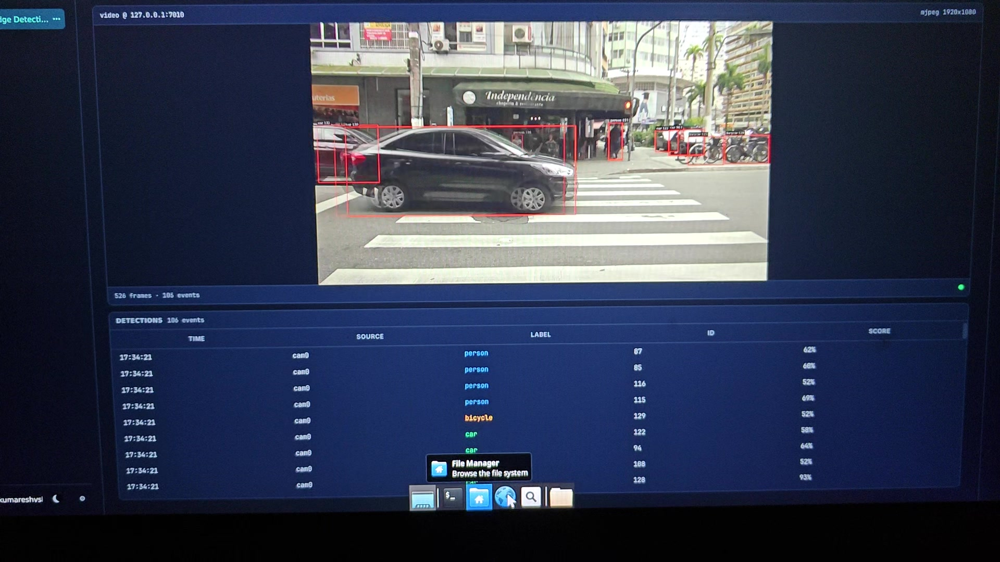
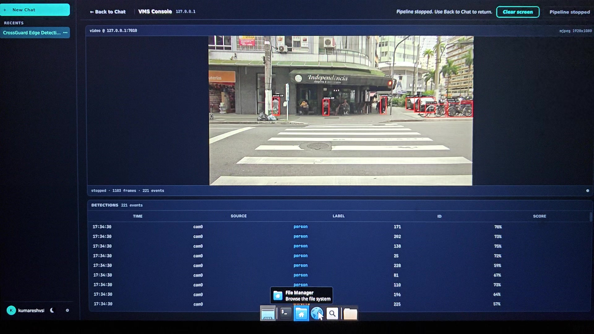

# CrossGuard Edge: Real-Time Edge Vision Safety Twin for Intersection & Crosswalk Monitoring

[](https://craftifai.com)
[](https://developer.nvidia.com/deepstream-sdk)
[](https://developer.nvidia.com/tensorrt)
[](https://www.nvidia.com)
[](LICENSE)

CrossGuard Edge is an edge-native AI vision pipeline designed for intelligent transportation systems (ITS) and smart crosswalk safety. Built with **CraftifAI PipeGen v0.5.1**, **NVIDIA DeepStream 7.1**, and **TensorRT 10.3.0**, the system performs real-time detection, tracking, and spatial conflict analysis of pedestrians and vehicles inside road crossing zones to mitigate pedestrian collisions.

---

## 📌 Problem Statement

Pedestrian crossings and urban intersections represent high-risk conflict zones where vehicles and vulnerable road users (VRUs) intersect. Traditional camera systems act as passive recording devices without real-time threat detection. 

**CrossGuard Edge** transforms passive traffic cameras into proactive safety monitors by:
1. Ingesting high-definition video feeds at the edge with near-zero latency.
2. Detecting pedestrians, cars, buses, trucks, motorcycles, and bicycles with a hardware-accelerated YOLO11s detector.
3. Maintaining persistent multi-target trajectories using DeepStream `nvtracker`.
4. Evaluating spatial conflict zones using ray-casting point-in-polygon checks on ground-contact anchors to detect simultaneous pedestrian and vehicular occupancy.
5. Emitting timestamped, deduplicated safety event alerts to intelligent traffic controllers and connected V2X infrastructure.

---

## 🏗️ System Architecture

The pipeline is compiled using **CraftifAI PipeGen** into an optimized NVIDIA DeepStream graph, complemented by a modular safety post-processor:

```mermaid
graph LR
    A[Input 1: 1080p Video / Camera] -->|NVMM Video/Raw| B[nvvideoconvert: Letterbox 640x640 RGB]
    B -->|FP32 Tensor| C[nvinfer: YOLO11s TensorRT Engine]
    C -->|Raw Boxes & Scores| D[nvdsparsebbox: Bounding Box Decoder & NMS]
    D -->|Detections| E[nvtracker: Multi-Object Tracking]
    E -->|Tracked Objects| F[nvcustomprocess: libmeta_json & libvms_detect]
    F -->|Live OSD Display| G[Sink 1: Live Display / TCP 7010]
    F -->|Telemetry Stream| H[Sink 2: output/metadata.json & cam0.jsonl]
    H -->|Detections & Tracks| I[PostProc: CrossGuard Conflict Zone Analyzer]
    I -->|Active Safety Alerts| J[postproc/safety_events.json]
```



### Detailed Pipeline Stages

| Node ID | Node Name | Implementation | Function |
| :--- | :--- | :--- | :--- |
| **Node 1** | `input` | `nvurisrcbin` / `nvstreammux` | Decodes 1080p 60fps video / V4L2 camera source, batches frames. |
| **Node 2** | `preprocess` | `nvvideoconvert` | Resizes and letterboxes frames to $640 \times 640$ normalized RGB float32 tensor. |
| **Node 3** | `inference` | `nvinfer_backport` | Executes compiled `yolo11s.fp32.plan` engine on RTX 4060 Tensor Cores. |
| **Node 4** | `postprocess` | `libconfig_det_pgie_parser.so` | Decodes $1 \times 84 \times 8400$ output tensor, filters confidence $\ge 0.5$, runs NMS. |
| **Node 5** | `custom (tracking)` | `nvtracker` | Multi-object association and tracking (`libnvds_nvmultiobjecttracker.so`). |
| **Node 6** | `display` | `nvdsosd` + `fpsdisplaysink` | Renders bounding boxes, class labels, and tracking IDs to live display/sink. |
| **Node 7** | `output (json)` | `libmeta_json.so` | Writes timestamped per-frame metadata records to `output/metadata.json`. |
| **Modular** | `safety postproc`| `crossguard_postproc.py` | Ingests metadata and evaluates `zone_config.json` conflict polygon. |

---

## ⚡ TensorRT Benchmark & Performance Report

The model stage was compiled and benchmarked directly on target edge hardware using TensorRT 10.3.0 and logged in `model_stage/ModelStage.json`.

### Hardware Profile
- **Target Device:** NVIDIA GeForce RTX 4060 Laptop GPU (Ada Lovelace architecture, Compute Capability `sm_89`)
- **TGP / Power Cap:** 80 W
- **Driver:** NVIDIA UNIX x86_64 Driver 595.84
- **Host Runtime:** Ubuntu Linux x86_64

### Compilation & Benchmark Metrics

| Metric | Measured Value | Provenance / Measurement Source |
| :--- | :--- | :--- |
| **Engine Artifact** | `yolo11s.fp32.plan` | Generated by TensorRT 10.3.0 |
| **Engine File Size** | **47.6 MB** (47,618,772 bytes) | File system check |
| **Precision** | **FP32** (232 FP32 layers, 1 fallback) | TensorRT layer inspector |
| **Engine Graph Layers** | 233 TRT layers (from 321 ONNX nodes) | `model_stage/compile.data.json` |
| **Compilation Build Time** | **2.9 seconds** | TensorRT builder |
| **End-to-End Frame Time** | **5.468 ms** | `trtexec` hardware benchmark |
| **GPU Compute Time** | **4.848 ms** | `trtexec` telemetry |
| **Host ↔ Device Transfer** | **0.620 ms** | Derived transfer latency |
| **Inference Throughput** | **~183 FPS** (182.88 fps) | Derived from end-to-end latency |
| **Operational Power** | **72.74 W** | `nvidia-smi` active telemetry |
| **Compilation Accuracy (mAP50)** | **0.9954** | Evaluated across 30 verification samples vs. ONNX |

---

## 🧪 Validated Pipeline Working Run

The end-to-end pipeline was executed on the target hardware with live test footage (`crosswalk.mp4`, 1183 frames, 19.74 seconds at 59.94 fps).

### Execution Summary (`.run_output.txt`)
- **Execution Time:** 19.737 seconds (processed at full 60 fps real-time speed without dropped buffers).
- **Frames Processed:** 1,183 frames.
- **Total Objects Detected:** 14,490 detections across 80 COCO classes (primarily `person`, `car`, `bicycle`, `bus`, `truck`).
- **Telemetry Event Log:** 223 events streamed to `pipeline/deepstream/store/events/cam0.jsonl`.
- **Conflict Zone Safety Events:** 5 critical pedestrian-vehicle simultaneous occupancy events flagged by `postproc/crossguard_postproc.py`.

### Genuine Working-Run Evidence
Actual video frames captured from the live DeepStream VMS Console execution on the RTX 4060 laptop:

| Live Detections & Tracking (Frame 526) | Pipeline Completion & Event Log (Frame 1103) |
| :---: | :---: |
|  |  |
| *Active bounding boxes and tracker IDs on pedestrian and vehicle streams.* | *VMS console summary showing 1,103 frames processed and 221 detection events.* |

---

## 📂 Repository File Structure

```text
CraftifAIHackathon_<ID>/
├── .gitignore                          # Excludes large videos (>20MB), credentials, and caches
├── README.md                           # Comprehensive documentation and verified benchmarks
├── PipelineIR.json                     # PipeGen Intermediate Representation graph (7 nodes, 9 links)
├── RequirementState.json               # PipeGen requirement tracking state
├── UserInfo.json                       # Project parameters, model references, and scan summary
├── state.json                          # PipeGen multi-stage state (Req, PIR, Model, Compiler, Run: OK)
├── .pir_bindings.json                  # Low-level pipeline binding definitions
├── .cache/                             # PipeGen evidence records and scan artifacts
├── evidence/                           # Verified working-run screenshots from genuine execution
│   ├── working_run_live_detections.jpg
│   └── working_run_pipeline_summary.jpg
├── model_stage/                        # TensorRT compilation files and benchmark reports
│   ├── ModelStage.json                 # Detailed TRT benchmark report (latency, power, layers)
│   ├── ModelStage.log                  # Chronological step-by-step model stage log
│   ├── yolo11s.fp32.plan               # Compiled TensorRT FP32 engine (47.6 MB)
│   ├── yolo11s.fp32.plan.key           # Model stage correlation key
│   ├── compile.data.json               # Layer breakdown and kernel tactician details
│   ├── engine.data.json                # Roofline compute model and hotspot profiling
│   └── yolo11s.fp32.runtime.profile.json
├── pipeline/deepstream/                # DeepStream pipeline implementation
│   ├── configs/                        # Primary inference & tracker configs
│   │   ├── config_det_pgie.txt
│   │   └── config_tracker.yml
│   ├── labels/                         # COCO class labels
│   ├── parsers/                        # C++ custom parser and metadata plugins
│   │   ├── Makefile
│   │   ├── config_det_pgie_parser.cpp
│   │   ├── meta_json.cpp
│   │   ├── vms_detect.cpp
│   │   └── *.h
│   ├── build/                          # Compiled custom shared libraries (.so)
│   ├── output/                         # Verified run metadata
│   │   └── metadata.json               # 1,183 frames of detection records
│   ├── store/events/                   # Streamed JSONL event storage
│   │   └── cam0.jsonl
│   ├── .run_output.txt                 # Terminal execution log showing EOS after 19.737s
│   └── run.sh                          # Pipeline launch script
├── postproc/                           # Modular safety conflict analyzer
│   ├── crossguard_postproc.py          # Ray-casting point-in-polygon conflict processor
│   ├── zone_config.json                # Crosswalk conflict polygon definition
│   └── safety_events.json              # Emitted collision risk alerts
└── src1/VehicleDetection/              # Baseline source code
    ├── application.py                  # Initial single-image ONNX detector verification script
    └── model/
        ├── download.sh                 # Model download utility
        └── yolo11s.onnx                # Pretrained YOLO11s ONNX model (37 MB)
```

---

## 🚀 Setup & Execution Guide

### Prerequisites
1. **Host Environment:** Ubuntu 22.04 / 24.04 LTS (x86_64)
2. **GPU:** NVIDIA GPU with Turing, Ampere, or Ada Lovelace architecture (`>= 6 GB VRAM`)
3. **NVIDIA Driver:** `>= 535.x` (verified with `595.84`)
4. **Container Engine:** Docker with `nvidia-container-toolkit` installed.
5. **DeepStream:** NVIDIA DeepStream SDK 7.1 (or CraftifAI PipeGen Docker image `craftifaidocker/deepstream:7.1-amd64-v3`).

### 1. Launching the DeepStream Pipeline

To execute the pipeline directly in the target environment:

```bash
cd pipeline/deepstream

# Optional: Rebuild custom C++ parsers if modifying schemas
make -C parsers

# Execute the pipeline using a video file or camera input
./run.sh
```

To configure custom video sources or camera inputs:
```bash
# Using a local video file
JSON_OUT=output/metadata.json gst-launch-1.0 -e nvstreammux name=mux batch-size=1 width=1920 height=1080 ! ...

# Using a live USB webcam
CAM=/dev/video0 CAM_W=1920 CAM_H=1080 CAM_FPS=30 ./run.sh
```

### 2. Running the Safety Conflict Post-Processor

The post-processor ingests the DeepStream metadata output and validates detections against the crosswalk conflict polygon:

```bash
cd postproc

# Run conflict zone detection
python3 crossguard_postproc.py \
  --metadata ../pipeline/deepstream/output/metadata.json \
  --config zone_config.json \
  --output safety_events.json
```

**Sample Output from Verified Run:**
```text
[CrossGuard PostProc] Ingesting metadata: ../pipeline/deepstream/output/metadata.json
[CrossGuard PostProc] Ingesting config:   zone_config.json
[CrossGuard PostProc] Analysis complete!
[CrossGuard PostProc] Frames analyzed: 1183
[CrossGuard PostProc] Safety events triggered: 5
[CrossGuard PostProc] Output saved to: safety_events.json
```

---

## 📥 Input & Output Specifications

### Input Formats
- **Video:** MP4 / MKV / H.264 / H.265 up to 1080p at 30/60 fps.
- **Live Stream:** V4L2 USB camera (`/dev/video0`) or RTSP IP camera streams.

### Output Schemas

#### 1. Per-Frame Metadata (`output/metadata.json`)
```json
{
  "frame": 29,
  "source_id": 0,
  "pts_ns": 517183333,
  "width": 1920,
  "height": 1080,
  "objects": [
    {
      "id": 11,
      "class_id": 0,
      "label": "person",
      "confidence": 0.5774,
      "bbox": { "left": 1209.2, "top": 426.7, "width": 45.8, "height": 142.8 },
      "tracker_confidence": 0.82
    }
  ]
}
```

#### 2. Safety Conflict Event Alert (`postproc/safety_events.json`)
```json
{
  "event_id": "EVT_0001",
  "camera_id": "cam_crosswalk_01",
  "type": "PEDESTRIAN_VEHICLE_CONFLICT",
  "severity": "CRITICAL",
  "trigger_frame": 29,
  "timestamp_sec": 0.517,
  "conflict_zone": "crosswalk_conflict_zone",
  "pedestrians_in_zone_count": 6,
  "vehicles_in_zone_count": 1,
  "pedestrian_tracks": [11, 2, 6, 5, 8, 3],
  "vehicle_tracks": [17]
}
```

---

## 🔍 Validation Status & Honest Limitations

In strict adherence to engineering integrity and hackathon rules:
1. **Test Footage:** The sample video at `/home/neophiloz/Videos/CrossGuard/crosswalk.mp4` is public domain test footage (Pexels, 1080p, 60fps) chosen to stress-test high-density pedestrian and vehicle flow. It is used as test input for pipeline validation, not as field proof of commercial production deployment.
2. **Precision Level:** The compiled TensorRT engine runs at reference **FP32** precision (`5.468 ms` per frame). INT8 post-training calibration was not executed for this submission to avoid quantization drift without a labeled crosswalk calibration set.
3. **Pipeline IR Screenshot:** The underlying structured node graph (`PipelineIR.json`) is fully preserved and validated; a direct GUI screenshot of the PipeGen graph editor canvas is not included in the repository files and should be captured from the PipeGen interactive interface.
4. **Demo Video Hosting:** Per GitHub repository guidelines, large video files (>50MB) are excluded from git. A genuine 28.4-second proof-of-run video (`VID20261016230405.mp4`) exists locally; the final 1–3 minute submission demo recording must be viewed via its external hosting link.

---

## 👥 Authors & Acknowledgments

- **Developer:** MYSTICFAE04 ([kumareshvsbeee@gmail.com](mailto:kumareshvsbeee@gmail.com))
- **Hackathon:** CraftifAI Physical AI Hackathon
- **Built With:** [CraftifAI PipeGen](https://craftifai.com), [NVIDIA DeepStream](https://developer.nvidia.com/deepstream-sdk), and [NVIDIA TensorRT](https://developer.nvidia.com/tensorrt).
